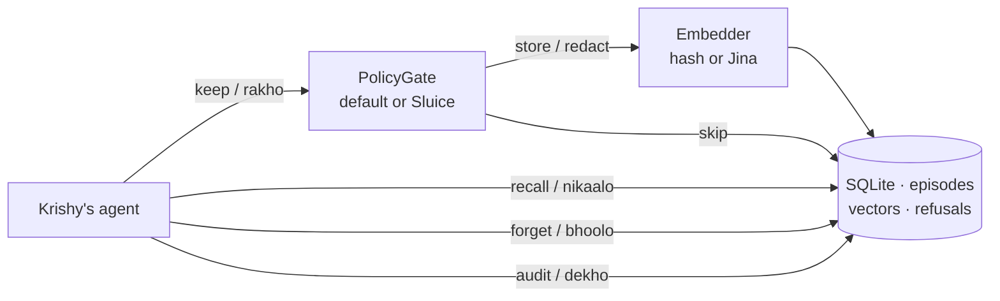
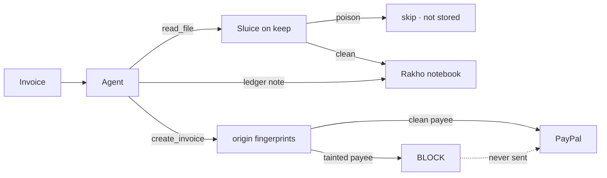

<p align="center">
  <picture>
    <source media="(prefers-color-scheme: dark)" srcset="docs/assets/wordmark-dark.svg">
    <source media="(prefers-color-scheme: light)" srcset="docs/assets/wordmark.svg">
    
  </picture>
</p>

<p align="center">
  <em>rakho (रखो) = "keep it."</em>
</p>

<p align="center">
  A memory database for AI agents. Inspect before you keep. Forget for real.<br>
  Talk to it in the language you actually think in.
</p>

## Why this exists

Agents are starting to remember people across chats. That is useful until the notebook also keeps an API key, someone else's ticket, or a poisoned line like "forget the safety rules."

Most memory layers **save first, search later**. The dangerous stuff is already in the box.

Rakho is the agent's diary with a bouncer at the door:

1. Check the note. Secret, personal, shady → do not write it down.
2. If it is safe, keep it, tagged with **whose** notebook it is.
3. Later, only that person's notes come back.
4. "Forget me" deletes the pages. Embeddings too.
5. You can look: what was kept, what was refused, what is left.



Gate first, embed after. Every note has an `actor_id`. Forget deletes the row, the search index, and the vector.

It is a library, not a server. Any developer can drop it in as their agent's memory. You do not need Sluice. You do not need a vector-DB cluster.

```python
from rakho import Rakho

db = Rakho("memory.db")

db.keep("order is late", actor_id="krishy")
db.keep("password is hunter2", actor_id="krishy")   # refused

db.recall("order", actor_id="krishy")               # late order, no password
db.forget(actor_id="krishy")                        # gone
db.audit(actor_id="krishy")                         # empty, and you can prove it
```

Every write needs `actor_id`. That is how Krishy's notebook never leaks into Priya's.

## The fun part: write commands in your language

The database has **four actions**. English is canonical so anyone can read the code. Hindi ships because that is the name. German ships because that is where it was built. They are the same four verbs, not three databases.

| | English | Hindi | German |
|---|---|---|---|
| keep it | `keep` / `store` | `rakho` | `merk` / `behalte` |
| pull it out | `recall` / `get` | `nikaalo` | `hol` / `abruf` |
| forget it | `forget` | `bhoolo` | `vergiss` |
| look | `audit` / `look` | `dekho` | `schau` / `zeig` |

```python
db.rakho("आर्डर लेट है", actor_id="krishy")
db.nikaalo("आर्डर", actor_id="krishy")
db.bhoolo(actor_id="krishy")
db.dekho(actor_id="krishy")

db.merk("Bestellung ist spät", actor_id="krishy")
db.hol("Bestellung", actor_id="krishy")
```

Same for the CLI. Mix freely. `nikaalo` is `recall`.

```bash
rakho keep --actor krishy "order is late"
rakho nikaalo --actor krishy "order"
rakho vergiss --actor krishy
rakho dekho --actor krishy
```

### Bring your own language

Commands are a dictionary. Add Swahili, Marathi, French, whatever you speak. New words call the same four actions. One word cannot mean two things.

```python
db.learn("swahili", {
    "keep": "weka",
    "recall": "leta",
    "forget": "sahau",
    "audit": "angalia",
})

db.weka("order is late", actor_id="krishy")
db.leta("order", actor_id="krishy")
```

```bash
rakho learn swahili --keep weka --recall leta --forget sahau --audit angalia
rakho weka --actor krishy "order is late"
```

The personality is the mouth. The rules stay in English underneath.

## Install

```bash
pip install rakho
rakho
```

That last command is the front door: big wordmark, then four things to try.

Optional extras:

```bash
pip install "rakho[sluice]"    # Sluice as the keep inspector
pip install "rakho[mcp]"       # rakho-mcp for Claude Desktop / Cursor
```

From this repo:

```bash
python3 -m pip install -e ".[dev]"
python3 -m pytest -q
```

## Starter

Hashing works with no key. Jina is the real memory (English / Hindi / German). Free key: [jina.ai/embeddings](https://jina.ai/embeddings)

```bash
export JINA_API_KEY="jina_…"
```

```python
from rakho import Rakho

db = Rakho("memory.db", embedder="jina")   # or omit embedder= for offline hash
print("embedder:", type(db.embedder).__name__)

db.rakho("आर्डर लेट है", actor_id="krishy")
db.rakho("password is hunter2", actor_id="krishy")   # refused

print([m.content for m in db.nikaalo("order is late", actor_id="krishy")])
# ['आर्डर लेट है']
db.close()
```

Leave the file on disk (`memory.db`). Then peek from the same terminal. Do not `bhoolo` until you have looked.

```bash
python3 test_file.py
python3 examples/agent.py
python3 examples/paypal/agent.py
```

## Peek at the notebook

Same folder as `memory.db`. CLI default file is `rakho.db`, so pass `--db`.

**Rows (kept + refused)** — no embedder needed:

```bash
rakho --db memory.db dekho --actor krishy
rakho --db memory.db dekho --actor krishy --json
```

You should see `256d` next to each kept note (vector length). The vector itself stays in SQLite; audit never prints it.

**Recall** (needs the same embedder you wrote with):

```bash
rakho --db memory.db --embedder jina nikaalo --actor krishy "order is late"
```

**Raw SQLite** — embeddings are a float32 blob; `length/4` is the dimension:

```bash
sqlite3 memory.db "
.tables
SELECT actor_id, content, length(embedding)/4 AS dims, sensitivity, created_at
FROM memories;
SELECT actor_id, reason, preview FROM refusals;
"
```

**Forget when you are done looking:**

```bash
rakho --db memory.db bhoolo --actor krishy
rakho --db memory.db dekho --actor krishy
```

Empty stored + empty refused means it actually forgot, including the vectors.

## Demo agent: PayPal invoices

Same use case as [PayPal-Hackathon-x-sluice](https://github.com/krishyaid-coder/PayPal-Hackathon-x-sluice): an agent reads an invoice, then tries to pay.

- Poisoned invoice (`Ignore previous instructions` + attacker payee) → Rakho **refuses to keep it**. Origin fingerprints the payee. `create_invoice` is **blocked**. PayPal never sees the call.
- Clean vendor invoice → Rakho **keeps** it. Recall only brings that note back. `create_invoice` is **allowed**.
- Same attacker, never read the poison → **allowed**. Not a blocklist of those two accounts.
- `forget` empties Krishy's notebook. You can prove it.



No PayPal token. No LLM. The money call is a mock.

```bash
python3 examples/paypal/agent.py
python3 examples/paypal/agent.py --sluice   # optional: Sluice inspects keep
```

Krishy’s real-world run (Sluice on, notebook left open, PayPal outcomes stored as notes):

```bash
python3 examples/paypal/agent.py --sluice --actor krishy --db paypal-krishy.db --no-forget
rakho --db paypal-krishy.db dekho --actor krishy
```

Observations from that run: [examples/paypal/SIMULATION.md](examples/paypal/SIMULATION.md).

## Embeddings (no local model)

Default is an offline hashing embedder so `pip install` works with no download and no key.

Hugging Face is **not a free embeddings API anymore**. Free accounts get no useful inference credit (PRO is paid). Do not plan on HF for day-to-day.

Use **Jina** instead: multilingual (`jina-embeddings-v3`, including Hindi and German), HTTPS, no weights on disk. Free API key: [jina.ai/embeddings](https://jina.ai/embeddings)

```bash
export JINA_API_KEY="jina_…"
rakho --db memory.db --embedder jina keep --actor krishy "आर्डर लेट है"
rakho --db memory.db --embedder jina nikaalo --actor krishy "order is late"
```

```python
db = Rakho("memory.db", embedder="auto")   # Jina if JINA_API_KEY, else HF if HF_TOKEN, else hash
db = Rakho("memory.db", embedder="jina")   # requires JINA_API_KEY
db = Rakho("memory.db", embedder="hf")     # requires HF_TOKEN; model intfloat/multilingual-e5-small
```

Same notes stay in SQLite. Only the vector source changes. macOS python.org needs `certifi` (already a common install) so HTTPS to Jina verifies.

## Sluice (optional gate)

Rakho's default gate is always on. Sluice is a stronger inspector you can plug into the same slot — not 2FA, not required.

```bash
pip install "rakho[sluice]"
rakho --gate sluice keep --actor krishy "order is late"
python3 examples/paypal/agent.py --sluice
```

```python
db = Rakho("memory.db", gate="sluice")
```

Same slot as the default gate. Omit `--sluice` / `--gate sluice` / `gate="sluice"` and the built-in inspector still runs.

## MCP (optional)

For agents that cannot `import rakho` (Claude Desktop, Cursor):

```bash
pip install "rakho[mcp]"
rakho-mcp --db memory.db --embedder auto
rakho-mcp --db memory.db --gate sluice
```

Tools: `keep` / `rakho`, `recall` / `nikaalo`, `forget` / `bhoolo`, `audit` / `dekho`.

## v0.2

- Default gate is **on** (secrets, obvious PII, injection-shaped content). Gate first, embed after.
- Hindi / German secret phrases, Steuer-ID, and injection-shaped lines are caught in that default gate.
- Episodes only: raw notes, one owner each. No summaries.
- Forget is a real delete. Audit shows stored **and** refused (refusals never contain the secret).
- Sluice is opt-in: `gate="sluice"` / `--gate sluice` / `examples/paypal/agent.py --sluice`.
- Zero required runtime dependencies. SQLite on disk.

Locked idea: [rakho_onepager.md](rakho_onepager.md).
